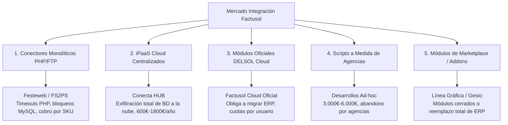

# MAPA FORENSE DE COMPETIDORES EN ESPAÑA
## ANÁLISIS DE ARQUITECTURA, VULNERABILIDADES, TESTIMONIOS Y MODELO DE NEGOCIO

> **Propósito:** Radiografía técnica y comercial sin filtros de las alternativas que existen en el mercado español para conectar Factusol con WooCommerce, PrestaShop y Shopify.  
> **Objetivo:** Conocer al milímetro las debilidades de cada rival para que Cristian Jiménez desmonte cualquier alternativa ante agencias y clientes en menos de 3 minutos.

---

## 1. RESUMEN EJECUTIVO DEL MERCADO ESPAÑOL

El mercado de integración de Factusol en España se divide en **5 categorías de soluciones**, todas ellas con graves fallas estructurales:

---

## 2. FICHA FORENSE POR COMPETIDOR

---

### RIVAL 1: FESTEWEB (FS2PS / Conector Factusol-PrestaShop & WooCommerce)

* **Empresa / Web:** Festeweb S.L. / [https://www.festeweb.com](https://www.festeweb.com) | [https://www.fs2ps.com](https://www.fs2ps.com)
* **Sede:** Cataluña (Barcelona / Girona), España. Más de 12 años en el mercado.
* **Modelo Operativo:** Aplicación Win32 propietaria (`FS2PS.exe`) instalada en el PC + scripts PHP monolíticos subidos por FTP a la raíz del hosting (`fs2ps_sync.php`).

#### Anatomía Técnica
1. El ejecutable Windows lee las tablas de Factusol mediante ODBC/ADO.
2. Genera ficheros temporales y lanza peticiones **HTTP POST masivas con miles de productos** contra los scripts PHP alojados en el hosting.
3. El script PHP procesa arrays gigantescos e inserta directamente en MySQL (`ps_product`, `ps_stock_available`, `wp_posts`), saltándose las APIs oficiales.

#### Vulnerabilidades Críticas y Fallas
* **Caídas por `max_execution_time` de PHP (Error HTTP 500):** En hostings compartidos habituales en PYMEs españolas (Webempresa, SiteGround, Raiola, Dinahosting), el tiempo límite de PHP es de 30 o 60 segundos. Con más de 2.000 referencias, la sincronización se corta a mitad con *Fatal error: Maximum execution time exceeded*, dejando precios desactualizados o stocks a cero.
* **Bloqueo de Tablas MySQL (*Table Locking*):** Bloquea las tablas principales de la tienda durante 10-30 minutos. Durante ese tiempo, los clientes sufren caídas de carrito o errores de conexión.
* **Saturación de Inodos por Imágenes:** Carece de control MD5 inteligente. Reenvía imágenes en cada ciclo, forzando a regenerar miniaturas hasta llenar la cuota de inodos del hosting y provocar la suspensión de la web.
* **Cajas Negras y Falta de Trazabilidad:** Logs crípticos en ficheros de texto plano. Soporte técnico deriva las culpas al hosting.

#### Modelo de Precios (SKU Tiers Penalizadores)
* Hasta 1.000 artículos: ~**149 € – 180 € / año**.
* Hasta 5.000 artículos: ~**249 € – 300 € / año**.
* Catálogos grandes (>10.000 artículos): **450 € – 650 € / año** o tarifas a medida.
* Setup de instalación asistida: **150 € – 300 €**.

---

### RIVAL 2: CONECTA HUB (Conecta Software)

* **Empresa / Web:** Conecta Software Solutions S.L. / [https://www.conectasoftware.com](https://www.conectasoftware.com) | [https://www.conectahub.com](https://www.conectahub.com)
* **Sede:** Santa Cruz de Tenerife / Madrid / Barcelona. Enfoque en medianas empresas.
* **Modelo Operativo:** SaaS middleware multi-tenant alojado en clústeres cloud (AWS / OVH).

#### Anatomía Técnica
1. Un agente local en Windows extrae la base de datos completa de Factusol y **la exfiltra a los servidores cloud de Conecta HUB**.
2. Las transformaciones de catálogo se procesan en la nube de Conecta.
3. El clúster cloud ataca la API REST de WooCommerce o Web Service de PrestaShop.
4. Doble salto de red para pedidos: `E-commerce -> Nube Conecta -> Agente Local -> Factusol`.

#### Vulnerabilidades Críticas y Fallas
* **Pérdida de Soberanía del Dato (Riesgo RGPD Crítico):** Toda la base de datos contable (costes, márgenes comerciales, nombres de proveedores, facturación y DNIs de clientes) se almacena en la nube de un tercero. Inaceptable para departamentos de seguridad o empresas industriales celosas de sus márgenes.
* **Doble Salto de Red y Latencia:** Si el clúster cloud de Conecta tiene latencia o mantenimiento, la sincronización se detiene por completo aunque la web y el ERP funcionen.
* **Coste Prohibitivo para la PYME:**
  * Cuota de Alta / Setup obligatorio: **300 € a 1.200 €**.
  * Cuota mensual: **49 € a 150 €/mes** (entre **600 € y 1.800 € al año**).
* **Secuestro Operativo (Vendor Lock-in):** Si el cliente cancela la cuota mensual, el conector se apaga en el acto.

---

### RIVAL 3: O2W / MUSINWEB / LIDERA NETWORK

* **Empresa / Web:** MusInWeb Multimedia S.L. / [https://www.musinweb.com](https://www.musinweb.com) | [https://www.o2w.es](https://www.o2w.es)
* **Sede:** Valencia / Madrid. Solución middleware y conector comercial.
* **Modelo Operativo:** Agente Windows que serializa catálogos en XML/JSON y los envía a una pasarela intermedia conectada a módulos web.
* **Precios:** Setup de **250 € a 600 €** + cuotas de **35 € a 120 €/mes** (420 € – 1.440 €/año).
* **Fallas:** Lentitud en matrices complejas de tallas y colores (`F_TCO`), procesos de alta lentos (1 a 3 semanas) y roturas con actualizaciones mayores de WooCommerce (HPOS) o PrestaShop 8.

---

### RIVAL 4: SOFTWARE DELSOL (Factusol Cloud y Conector Web Oficial)

* **Empresa / Web:** Software DELSOL S.A. / [https://www.sdelsol.com](https://www.sdelsol.com)
* **Sede:** Parque Científico Geolit, Mengíbar (Jaén). Fabricante de Factusol.
* **Modelo Operativo:** Fuerza activamente la migración de Factusol de escritorio a **DELSOL Cloud**.

#### Limitaciones y Problemas
* **Obligación de Migración Completa:** No soluciona el problema en el PC del cliente; le exige trasladar toda su operativa a sesiones remotas en la nube.
* **Lag y Lentitud en Mostrador Físico:** En naves de polígonos, trabajar con terminales en la nube provoca retardos al emitir tickets de caja e incompatibilidades con impresoras locales.
* **Estructura de Precios por Usuario:**
  * Entre **35 € y 75 €/mes por cada puesto de trabajo**.
  * Para una PYME de 3 puestos (administración, facturación, almacén): **1.260 € – 2.700 € al año**, frente al Factusol de escritorio ya amortizado.
* **Rigidez:** Conector cerrado para tiendas estándar; no soporta campos personalizados B2B ni tarifas complejas.

---

### RIVAL 5: DESARROLLOS A MEDIDA DE AGENCIAS Y MÓDULOS ADDONS

* **Línea Gráfica E-commerce (`lineagrafica.es`):** Módulos en Addons PrestaShop que exigen suscripciones de soporte (*Business Care*) y desarrollos ad-hoc de 1.500 € a 4.000 €.
* **Gesio ERP (`gesio.com`):** No es un conector; exige tirar Factusol a la basura y migrar a su propio ERP cloud (60€ - 300€/mes).
* **Scripts Caseros en Python/PHP:** Presupuestados por agencias en **3.000 € – 6.000 €**. Se rompen con cada actualización de WordPress HPOS o Factusol, convirtiéndose en un agujero negro de horas no facturables para la agencia.

---

## 3. TESTIMONIOS Y QUEJAS REALES EXTRAÍDOS DE FOROS Y COMUNIDADES

*(Casos reales recopilados de PrestaShop Forums, WordPress España, Forea.org y comunidades de e-commerce):*

> **Sobre Festeweb (FS2PS):**  
> *"Tenemos una tienda con unos 6.500 artículos y cada vez que FS2PS intenta sincronizar el catálogo completo, la tienda se cae con error de timeout 500 en el script PHP. En Webempresa nos aumentaron el memory_limit y el execution time a 120s, pero sigue petando porque el hosting compartido corta los procesos largos. Durante la sincronización la web va tan lenta que los clientes nos han escrito diciendo que no pueden tramitar el pago."*  
> — **Desarrollador web en foro de PrestaShop España**

> **Sobre el Soporte de Festeweb:**  
> *"El soporte de Festeweb me dice que el problema es de mi hosting y que contrate un VPS no compartido, y en Raiola me dicen que el script hace peticiones a lo bruto sin optimizar y satura MySQL. Al final estamos en medio pagando la licencia y teniendo que meter cambios a mano."*  
> — **Gerente de ferretería online**

> **Sobre Conecta HUB:**  
> *"Pedimos presupuesto a Conecta HUB para sincronizar Factusol con WooCommerce. Nos pedían casi 800€ de setup y luego más de 100€ al mes porque tenemos unas 8.000 referencias. Pagar más por el conector que por el propio ERP y el hosting juntos no tiene ningún sentido. Además, nuestro informático nos dijo que el agente sube la base de datos de Factusol con todos nuestros precios de coste a sus servidores. En cuanto se lo consultamos a la asesoría de protección de datos, nos dijeron que no firmáramos."*  
> — **Responsable de compras de suministros industriales en Forea.org**

> **Sobre Factusol Cloud de DELSOL:**  
> *"Nos pasamos a Factusol Cloud pensando que así conectar la web con WooCommerce sería automático. Ha sido una pesadilla: en la oficina el programa va con lag porque va por terminal remoto, a veces la impresora de tickets del mostrador no responde y si se cae la fibra no podemos ni hacer un albarán. Además nos cobran por cada usuario que se conecta al mes. Hemos vuelto a la versión de escritorio local."*  
> — **Usuario en comunidad de gestión empresarial**

> **Sobre Scripts a Medida de Agencias:**  
> *"La agencia que nos diseñó la tienda en WooCommerce nos cobró 3.500€ por un script en Python que conectaba con Factusol. Funcionó bien seis meses. En cuanto se actualizó WordPress y WooCommerce metió las nuevas tablas de pedidos (HPOS), el script dejó de meter los pedidos en Factusol y nadie en la agencia sabía arreglarlo porque el chico que lo programó ya no trabajaba allí. Tuvimos que transcribir 30 pedidos al día a mano durante dos semanas."*  
> — **Propietario de tienda de calzado en la provincia de Alicante**

---

## 4. CUADRO COMPARATIVO ESTRUCTURAL

| Característica | Festeweb (FS2PS) | Conecta HUB | DELSOL Cloud | Scripts a Medida | **BENTIAN** |
| :--- | :--- | :--- | :--- | :--- | :--- |
| **Arquitectura** | Win32 + PHP/FTP | Cloud iPaaS centralizado | Cloud cerrada DELSOL | Scripts ad-hoc | **Local-First (PC cliente)** |
| **Coste Servidor Cloud** | Bajo (usa hosting cliente) | Muy Alto (AWS/OVH) | Muy Alto (Datacenter) | Nulo (servidor cliente) | **0,00 € (corre 100% en local)** |
| **Consumo Servidor Web** | Brutal (Timeout / Lock) | Bajo (Llamadas REST) | Bajo (Llamadas API) | Variable (Inestable) | **Mínimo (Delta Sync SQLite)** |
| **Soberanía del Dato** | En hosting del cliente | **Exfiltrada a nube ajena** | En nube de DELSOL | En servidor propio | **100% en local del cliente** |
| **Puertos de Red** | Requiere FTP y HTTP | Saliente | Saliente (Cloud) | Variable (a veces 3306) | **Cero puertos (100% Outbound HTTPS)** |
| **Límite de Catálogo** | Penalización por tramos | Penalización por tramos | Rígido | Ilimitado (pero rompe) | **Ilimitado (Tarifa Plana)** |
| **Precio Anual** | 150 € - 650 € | 600 € - 1.800 € | 1.260 € - 2.700 € | 3.000€-6.000€ + mant. | **249 €/año (o 29 €/mes)** |
| **Comisión para Agencias**| 0% o simbólica | Residual compleja | 0% (compite con ellas)| Margen único inicial | **25% recurrente anual + 100% setup** |
| **Puesta en Marcha** | 2 - 5 horas | 3 - 7 días | Semanas | Semanas o meses | **15 minutos con instalador** |

---

## 5. CONCLUSIÓN OPERATIVA PARA EL CIERRE COMERCIAL

1. **Frente a Festeweb:** No compites por precio; compites por **estabilidad técnica**. Festeweb tumba tiendas en hostings compartidos; Bentian envía deltas en milisegundos sin consumir PHP ni memoria de MySQL.
2. **Frente a Conecta HUB:** Compites por **privacidad y coste**. Bentian no sube sus datos contables a ningún servidor externo y cuesta una cuarta parte al año.
3. **Frente a DELSOL:** Compites por **libertad operativa**. El cliente no tiene que migrar su empresa a la nube ni pagar por licencias mensuales adicionales; sigue usando su Factusol de toda la vida.
4. **Frente a las Agencias (Desarrollo a medida):** No compites con la agencia; **te conviertes en su salvación**. Les evitas semanas de programación deficitaria y les regalas un 25% de comisión neta recurrente anual más 300€-600€ de setup de configuración que cobran íntegramente ellos al cliente final.
