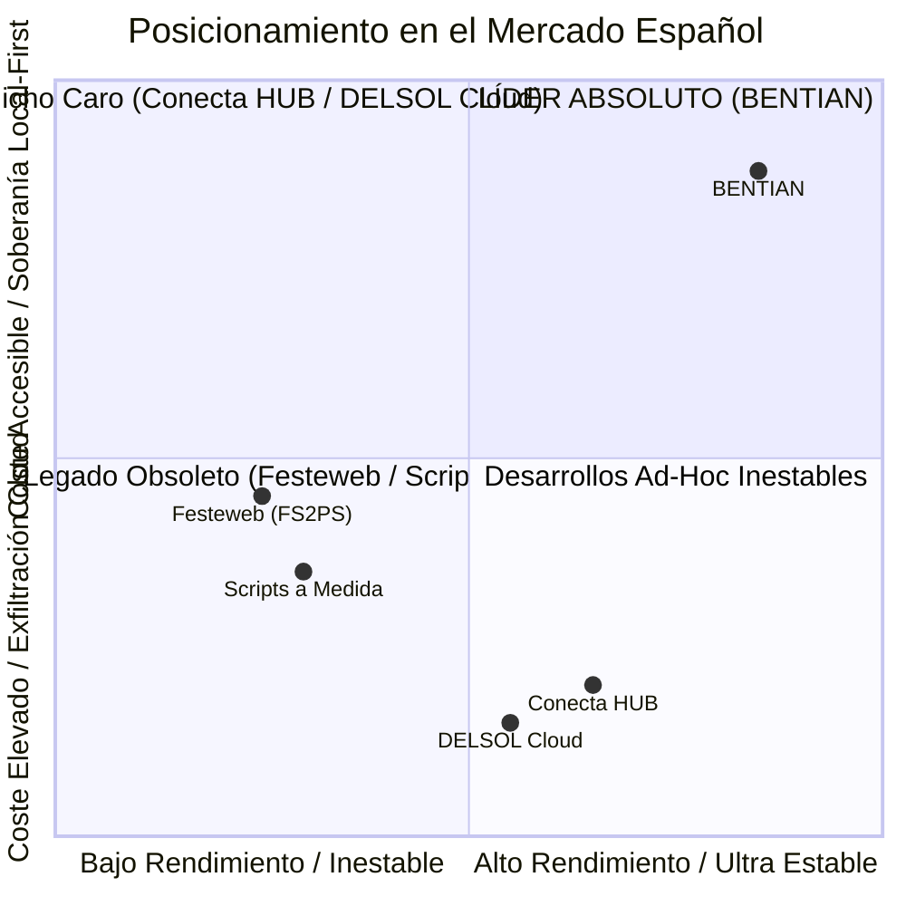

# MATRIZ DE DIFERENCIACIÓN FRONTAL Y BENCHMARKING TÉCNICO

> **Propósito:** Comparativa exhaustiva dimensión por dimensión de **Bentian** frente a las alternativas existentes en el mercado español.  
> **Uso:** Argumentario técnico de alto nivel para directores técnicos (CTOs), responsables de agencias e-commerce y técnicos de mantenimiento informático.

---

## 1. CUADRO COMPARATIVO MULTIDIMENSIONAL

| Dimensión Analizada | Festeweb (FS2PS) | Conecta HUB | DELSOL Cloud Oficial | Scripts a Medida | **BENTIAN (ERP Bridge)** |
| :--- | :--- | :--- | :--- | :--- | :--- |
| **1. Arquitectura Base** | Win32 + PHP scripts subidos por FTP a la web | iPaaS Cloud multi-tenant (AWS/OVH) | SaaS propietario centralizado en DELSOL | Scripts en Python / Node / cron jobs | **Local-First Nativo (Windows Service / SEA)** |
| **2. Custodia de la BD (.accdb)** | En local (pero vuelca tablas a MySQL vía PHP) | **Exfiltrada a servidores cloud externos** | **Aloja toda la contabilidad en su nube** | En local | **100% en local. Jamás abandona el PC** |
| **3. Ciberseguridad Perimetral** | Exige credenciales FTP y scripts expuestos en `/` | Conexión saliente a su clúster | Conexión saliente a DELSOL | A menudo exige abrir puerto MySQL 3306 | **Cero puertos abiertos (100% Outbound HTTPS)** |
| **4. Motor de Detección de Cambios** | Barrido completo de tablas en cada ciclo | Ingesta masiva en nube | Polling periódico en su nube | Comparación secuencial en base de datos | **Delta Sync SQLite de 3 capas con hash SHA-256** |
| **5. Tiempo de Ciclo (10.000 SKUs)** | 45 s - 3 min (o fallo por `max_execution_time`) | 1 - 3 min (doble salto de red) | 1 - 2 min | 2 - 10 min (según query) | **< 150 ms si no hay cambios; < 3 s en lote delta** |
| **6. Impacto en el Hosting Web** | Alto (bloqueo de tablas `wp_posts`/`ps_product`) | Bajo (llamadas REST controladas) | Bajo (llamadas API estándar) | Crítico (consultas lentas no indexadas) | **Nulo (solo viajan deltas empaquetados en JSON)** |
| **7. Modelo de Precios** | Tramos abusivos por número de productos | 50€-150€/mes + Alta de 300€-1.000€ | 35€-75€/mes por usuario del ERP | 3.000€-6.000€ inicial + soporte | **Tarifa Plana: 249 €/año o 29 €/mes ilimitado** |
| **8. Límite de Artículos** | Penaliza si superas 1k, 5k o 10k SKUs | Penaliza por volumen de llamadas/SKU | Limitado a planes corporativos | Sin límite teórico (pero revienta hosting) | **Catálogo ILIMITADO sin sobrecoste** |
| **9. Resiliencia ante Caídas** | Fallo crítico; no reintenta transacciones | Cola en la nube | Reintento estándar | Script se detiene y requiere intervención | **Cola local SQLite con reintento y backoff exp.** |
| **10. Mapeo Bidireccional Pedidos** | Escribe en Factusol sin control atómico | Descarga en nube y empuja al ERP | Integrado en Factusol Cloud | Inserción directa frágil en Access | **Descarga atómica con control de duplicados** |
| **11. Modelo Partner / Distribuidor** | No ofrece margen atractivo ni recurrencia | Margen residual complejo | 0% (compite frontalmente con agencias) | La agencia asume todo el riesgo y marrón | **25% anual recurrente + 100% del setup (300-600€)** |
| **12. Tiempo de Puesta en Marcha** | 2 - 5 horas (configuración manual PHP/FTP) | 3 - 7 días (onboarding corporativo) | Semanas (migración completa de ERP) | Semanas o meses de desarrollo | **15 minutos con instalador guiado en Windows** |

---

## 2. ANÁLISIS DE LAS VENTAJAS COMPETITIVAS IMBATIBLES DE BENTIAN

### 1. El Trilema Resuelto: Coste Cero de Servidor + Margen Máximo + Precio Insuperable
* **Competidores Cloud (Conecta HUB):** Cada cliente nuevo les cuesta dinero en servidores AWS, bases de datos PostgreSQL en la nube, memoria RAM y ancho de banda. Por eso tienen que cobrar 100 € al mes.
* **Bentian:** Al correr en el propio ordenador del cliente (*Local-First*), el coste de servidor en la nube para Bentian es **0,00 €**. Esto permite a Cristian cobrar **249 €/año**, mantener un margen bruto del **98%**, y regalar a la agencia un **25% de comisión recurrente neta** (62,25 € al año de por vida por cliente) sin pestañear.

### 2. Aprobación Inmediata por el Departamento de Informática (Cero Fricción de Seguridad)
* Cuando un técnico de mantenimiento informático de un polígono escucha: *"Hay que abrir el puerto 3306 de MySQL en el router"* o *"Hay que subir una copia de la base de datos de Factusol a un servidor en Francia"*, **veta la operación de inmediato por riesgo de ransomware y RGPD**.
* Cuando escucha la propuesta de Bentian: *"El ejecutable solo realiza peticiones salientes por HTTPS al dominio de la tienda web con TLS 1.3, no abre ningún puerto entrante y la base de datos nunca sale de este disco duro"*, **lo aprueba en 2 minutos** y se convierte en prescriptor del producto.

### 3. El Algoritmo Delta Sync de 3 Capas en SQLite Local
Bentian no sobrecarga la tienda web preguntando producto a producto. Dispone de un motor de hashes SHA-256 local que clasifica los cambios en tres niveles:
1. **Hash de Datos (`data_hash`):** Título, descripción, categorías, código de barras. (Frecuencia: 1 vez al día o bajo demanda).
2. **Hash de Precios (`price_hash`):** Tarifa general, tarifa mayorista, ofertas. (Frecuencia: cada 30 minutos).
3. **Hash de Stock (`stock_hash`):** Unidades físicas disponibles menos comprometidas. (Frecuencia: cada 2 a 5 minutos).

> Si una tienda tiene 25.000 productos y solo se han vendido 3 artículos en la última hora, Bentian envía exactamente un paquete JSON con **3 productos** a la API de WooCommerce. El servidor ni se entera.

---

## 3. AUDITORÍA HONESTA DE BRECHAS (GAP ANALYSIS) Y CÓMO GESTIONARLAS

Para mantener una credibilidad absoluta ante directores técnicos, Cristian debe conocer con total transparencia dónde se encuentra el producto hoy y qué respuestas dar:

| Capacidad del ERP | Estado en Bentian (v1.0) | Enfoque y Solución Inmediata | Roadmap v1.1 |
| :--- | :--- | :--- | :--- |
| **Producto Simple (Catálogo estándar)** | **100% Operativo y Testeado** | Ideal para suministros, ferretería, recambios, papelería, bricolaje, alimentación, hogar. | Optimización continua de batch. |
| **Variantes de Tallas y Colores (`F_TCO`)** | En desarrollo para v1.1 | Para empresas de calzado/moda con matriz compleja: se sincroniza como SKU simple independiente o se programa en la fase beta de 30 días. | Mapeo nativo a WooCommerce Variations / PrestaShop Combinations. |
| **Recargo de Equivalencia (R.E.)** | Mapeo configurable en IVA | Factusol gestiona el R.E. internamente; en WooCommerce se mapea con plugin estándar de checkout B2B español. | Integración nativa directa en el conector. |
| **Almacenes Múltiples (`F_ALM`)** | Lee Almacén General (GEN) | Se conecta al almacén principal de venta web de Factusol. | Soporte multi-origen con WooCommerce Multi-Location Inventory. |
| **Concurrencia de Access (`.ldb/.laccdb`)** | Manejo por driver ADODB | El agente lee en modo snapshot no bloqueante; no interrumpe el trabajo de los empleados en Factusol. | Implementación de retry backoff en colisiones (error `80004005`). |

---

## 4. CONCLUSIÓN ESTRATÉGICA

Bentian no es "otro script más". Es un **sistema de grado industrial** diseñado para eliminar para siempre la pesadilla de las integraciones de escritorio. En los sectores donde el producto simple manda (suministros industriales, recambios, ferretería, distribución, herramientas, fontanería, electricidad), **Bentian gana a Festeweb y a Conecta HUB en el 100% de las comparativas de fiabilidad, seguridad y precio.**
