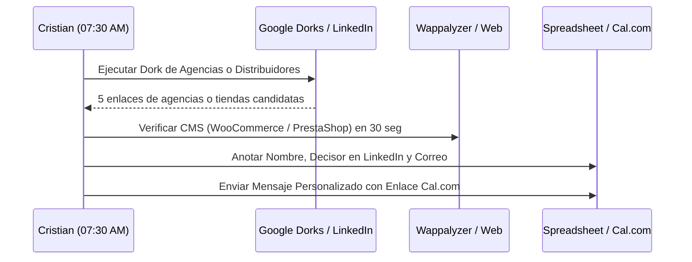

# HERRAMIENTAS DE DEEP SEARCH Y GOOGLE DORKS PARA PROSPECCIÓN
## DETECCIÓN AUTOMATIZADA DE PROSPECTOS CALIENTES Y PARTNERS B2B

> **Propósito:** Batería de consultas operativas avanzadas (Google Dorks, PublicWWW, BuiltWith y LinkedIn Boolean Search) para localizar con precisión quirúrgica agencias web, empresas de soporte IT y tiendas con Factusol en España, especialmente en la Comunidad Valenciana y Albacete.  
> **Uso:** Cristian puede ejecutar estas búsquedas en su bloque de 07:30 a 08:30 para generar una lista de 15 prospectos cualificados en menos de 10 minutos.

---

## 1. GOOGLE DORKS PARA DETECTAR TIENDAS E-COMMERCE CON FACTUSOL

Estas consultas rastrean páginas públicas de tiendas online españolas que mencionan a Factusol en sus condiciones generales, avisos de privacidad, descripciones de sincronización o metadatos.

```text
# Dork 1: Tiendas WooCommerce que mencionan Factusol o Software DELSOL en España
site:.es inurl:tienda OR inurl:shop "factusol" OR "software delsol" "woocommerce"

# Dork 2: Tiendas online con referencias a sincronización de stock o ERP Factusol
site:.es ("sincronizado con Factusol" OR "stock gestionado por Factusol" OR "facturado con Factusol")

# Dork 3: E-commerce de suministros, recambios o ferretería con Factusol en Albacete o Valencia
site:.es ("suministros industriales" OR "ferretería" OR "recambios") ("Factusol" OR "DELSOL") ("Valencia" OR "Albacete" OR "Alicante")

# Dork 4: Tiendas PrestaShop con módulos de integración con Factusol indexados
site:.es inurl:modules ("factusol" OR "fs2ps" OR "delsol")

# Dork 5: Ficheros de intercambio o catálogos expuestos por error de configuración
site:.es filetype:csv OR filetype:txt "F_ART" OR "F_STO" "articulo" "precio"
```

---

## 2. CONSULTAS EN PUBLICWWW (BUSCADOR DE CÓDIGO FUENTE INDEXADO)

[PublicWWW.com](https://publicwww.com) permite buscar cadenas de texto exactas dentro del código HTML/JS/CSS de millones de sitios web. Muy útil para cazar tiendas que usan plugins o scripts de competidores:

| Objetivo de Búsqueda | Query en PublicWWW | Qué Revela |
| :--- | :--- | :--- |
| **Tiendas con conector Festeweb (FS2PS)** | `"fs2ps"` o `"fs2ps_sync"` | Sitios que sufren con Festeweb y están abiertos a cambiar por cuelgues. |
| **Tiendas con conector Conecta HUB** | `"conecta-hub"` o `"conectahub"` | Clientes pagando 100€/mes que buscan reducir costes de integración. |
| **Tiendas WooCommerce con Factusol** | `"wp-content/plugins/" "factusol"` | Tiendas con plugins caseros o conectores de Factusol en WordPress. |
| **Sitios PrestaShop con scripts de DELSOL** | `"modules/delsol"` o `"modules/factusol"` | Comercios con módulos oficiales o de terceros en PrestaShop. |

---

## 3. GOOGLE DORKS PARA LOCALIZAR AGENCIAS WEB EN EL TARGET REGIONAL

Consultas diseñadas para encontrar agencias de tamaño pequeño/mediano (sweet spot: 3 a 15 empleados) que hacen tiendas en WooCommerce o PrestaShop en el área de actuación prioritaria.

```text
# Dork 6: Agencias e-commerce WooCommerce en Valencia capital y polígonos
("agencia desarrollo web" OR "diseño tiendas online") "woocommerce" ("Valencia" OR "Paterna" OR "Torrent" OR "Alzira") -inurl:blog

# Dork 7: Agencias PrestaShop y WooCommerce en Alicante y Elche
("diseño prestashop" OR "agencia woocommerce") ("Elche" OR "Alicante" OR "Torrellano" OR "Elda") "contacto"

# Dork 8: Agencias y estudios de diseño web en Albacete
("diseño web" OR "creación tiendas online") ("Albacete" OR "Campollano" OR "Almansa" OR "Villarrobledo") "contacto"

# Dork 9: Agencias que presumen de ser Agentes Digitalizadores (Kit Digital)
("agente digitalizador" OR "kit digital") ("diseño web" OR "comercio electrónico") ("Valencia" OR "Albacete" OR "Alicante") "woocommerce"

# Dork 10: Portfolios de agencias con clientes de polígonos industriales
site:.es intext:"diseño web por" ("suministros" OR "calzado" OR "distribución" OR "maquinaria") ("Valencia" OR "Albacete")
```

---

## 4. GOOGLE DORKS PARA LOCALIZAR EMPRESAS DE MANTENIMIENTO IT Y DISTRIBUIDORES

Las empresas de mantenimiento informático son los guardianes de los servidores de Factusol en los polígonos industriales.

```text
# Dork 11: Mantenimiento informático a empresas en polígonos de Valencia
("mantenimiento informatico empresas" OR "soporte sistemas pymes") ("Paterna" OR "Fuente del Jarro" OR "Ribarroja" OR "Almussafes")

# Dork 12: Mantenimiento informático y redes en Albacete (Campollano y Romica)
("mantenimiento informatico" OR "servidores empresas") ("Polígono Campollano" OR "Albacete" OR "Polígono Romica")

# Dork 13: Distribuidores y técnicos de Software DELSOL en la Comunidad Valenciana
("distribuidor oficial" OR "partner certificado") ("Software DELSOL" OR "Factusol") ("Valencia" OR "Alicante" OR "Castellón")

# Dork 14: Distribuidores y soporte Factusol en Castilla-La Mancha
("distribuidor" OR "soporte técnico") ("Factusol" OR "DELSOL") ("Albacete" OR "Ciudad Real" OR "Cuenca")
```

---

## 5. LINKEDIN BOOLEAN SEARCH (STRINGS PARA CONTACTAR DECISORES)

Copiar y pegar estos filtros directamente en la barra de búsqueda de LinkedIn (o Sales Navigator si se dispone de él) para encontrar a las personas con capacidad de decisión técnica y de alianzas:

### Para Agencias de Diseño Web y E-commerce (Target: Agencias Boutique)
```text
(CEO OR Fundador OR "Director de Proyectos" OR "Project Manager" OR CTO OR "Lead Developer") AND ("diseño web" OR "desarrollo web" OR "ecommerce" OR "woocommerce" OR "prestashop") AND (Valencia OR Alicante OR Elche OR Albacete)
```

### Para Empresas de Mantenimiento IT y Soporte de Sistemas
```text
("Director Técnico" OR "Responsable de Sistemas" OR "Gerente" OR "Administrador de Sistemas" OR "Soporte IT") AND ("mantenimiento informático" OR "servicios IT" OR "redes y servidores") AND (Valencia OR Albacete OR Alicante)
```

### Para PYMEs Industriales Directas (Gerentes y Responsables de E-commerce)
```text
("Gerente" OR "Director General" OR "Responsable de E-commerce" OR "Responsable de Compras") AND ("suministros industriales" OR "ferretería" OR "calzado" OR "recambios") AND (Campollano OR "Elche Parque Empresarial" OR Almansa OR Paterna)
```

---

## 6. DIRECTORIOS INDUSTRIALES Y ASOCIACIONES CLAVE

Búsqueda y extracción manual o asistida en censos empresariales públicos:

1. **Directorio del Polígono Campollano (ADECA - Albacete):**
   - URL: `https://adeca.com/directorio-empresas/`
   - Búsqueda: Sector "Suministros Industriales", "Ferretería", "Informática y Telecomunicaciones".
2. **Directorio de Elche Parque Empresarial:**
   - URL: `https://elcheparqueempresarial.es/empresas/`
   - Búsqueda: Sector "Calzado", "Moda y Confección", "Servicios Tecnológicos".
3. **Censo de Agentes Digitalizadores Oficiales (Acelera Pyme):**
   - URL: `https://www.acelerapyme.gob.es/kit-digital/catalogo-digitalizadores`
   - Filtro: Categoría "Comercio Electrónico", Provincia: Valencia, Alicante, Albacete. (Identifica agencias que han cobrado fondos europeos de 2.000€ por tienda y necesitan conectar Factusol urgentemente).
4. **Asociación Valenciana de Empresas del Sector TIC (AVALNET):**
   - Directorio de socios tecnológicos con división de desarrollo web y software de gestión.
5. **Cámara de Comercio de Valencia / Albacete / Alicante:**
   - Listados públicos de empresas de comercio mayorista y distribución.

---

## 7. FLUJO DE TRABAJO RÁPIDO (10 MINUTOS / MAÑANA)


