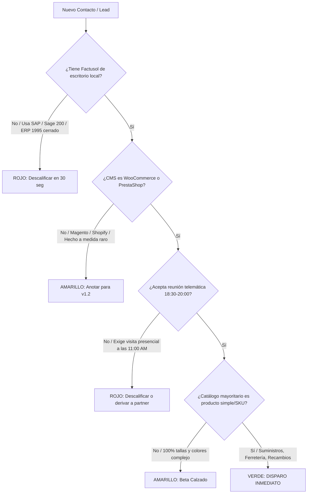

# FILTRO DE CUALIFICACIÓN DE LEADS EN 3 MINUTOS
## PROTOCOLO ANTI-PÉRDIDA DE TIEMPO PARA OPERATIVA EN PLURIACTIVIDAD

> **Contexto de Cristian:** Con una jornada laboral por cuenta ajena durante el día (08:30 a 18:30), las ventanas de atención comercial son limitadas y de altísimo valor:  
> - **Mañana (07:30 - 08:30):** 60 min de prospección y cualificación en frío.  
> - **Tarde (18:30 - 20:30):** 120 min para reuniones telemáticas de 20 min y cierres.  
> **Regla de Oro:** *"Un lead mal cualificado no es una oportunidad; es una hora de sueño o de desarrollo perdida."*

---

## 1. EL SISTEMA SEMÁFORO DE CUALIFICACIÓN INMEDIATA

Antes de agendar una videollamada o dedicar más de 3 minutos a un prospecto, somételo a este filtro implacable:

---

### VERDE: OPORTUNIDAD DE ORO (Disparar Demo y Cierre Inmediato)
* **Perfil:** Agencia boutique de diseño web (3 a 12 empleados) o empresa de mantenimiento informático que tiene al menos 1 cliente con Factusol de escritorio y tienda en WooCommerce o PrestaShop.
* **Tipo de catálogo:** Suministros industriales, ferretería, fontanería, electricidad, repuestos, papelería, cosmética, alimentación o droguería (producto simple con referencia directa).
* **Comportamiento:** Aceptan demo telemática de 15 minutos en horario de tarde (18:30 a 20:00).
* **Acción:** Enviar enlace de reserva de Cal.com y cerrar en la misma semana.

---

### AMARILLO: OPORTUNIDAD CONDICIONAL / NUTRICIÓN
* **Perfil:** 
  * Cliente con catálogo de calzado/moda que exige matriz pura de tallas y colores (`F_TCO`).
  * Agencia que actualmente no tiene ningún proyecto abierto de Factusol, pero afirma que "le entran 2 o 3 al año".
  * Empresas con PrestaShop que tienen versiones antiguas (1.6) o configuraciones muy atípicas.
* **Acción:** Enviar presentación ejecutiva en PDF y acuerdo de partner para firma diferida. Añadir a lista de difusión mensual de novedades. NO agendar llamada de 20 minutos de forma prioritaria.

---

### ROJO: DESCALIFICACIÓN FULMINANTE (Coste Inasumible)
* **Perfil:**
  * Empresas que usan ERPs propietarios cerrados sin base de datos accesible ni ODBC.
  * Empresas que ya migraron a Factusol Cloud oficial y no tienen problemas con él.
  * Gerentes que exigen reuniones presenciales por la mañana en su oficina a las 11:00 AM.
  * Agencias "piratas" que buscan un programador freelance que les haga horas de desarrollo a medida gratis o por 100€.
  * Prospectos que exigen soporte presencial de guardia o SLA de 15 minutos 24/7.
* **Acción:** Aplicar Guión de Descalificación Educada en menos de 1 minuto y cerrar el caso.

---

## 2. LAS 3 PREGUNTAS DEL TEST DEL ALGODÓN (VÍA LINKEDIN / EMAIL)

Envía estas 3 preguntas en el primer intercambio de mensajes para determinar la viabilidad antes de agendar nada:

1. **Sobre el ERP:**  
   > *"Para confirmar compatibilidad técnica directa: ¿Vuestros clientes utilizan Factusol de escritorio instalado en local (servidor Windows o PC) o están en la versión en la nube de Factusol Cloud?"*  
   * *Respuesta válida:* Servidor Windows / PC local / Red local.  
   * *Alerta roja:* "Todo en la nube de DELSOL sin acceso a archivos".

2. **Sobre la Plataforma E-commerce:**  
   > *"¿La tienda online está desarrollada sobre WooCommerce (WordPress) o PrestaShop?"*  
   * *Respuesta válida:* WooCommerce (cualquier versión) o PrestaShop 1.7 / 8.x.  
   * *Alerta amarilla/roja:* "Magento 1.9", "desarrollo propio en PHP desde cero".

3. **Sobre el Tipo de Catálogo:**  
   > *"¿El catálogo se gestiona por referencia directa/producto simple (suministros, recambios, ferretería, etc.) o maneja matrices de tallas y colores?"*  
   * *Respuesta válida:* Suministros, referencias simples, repuestos, consumibles.  
   * *Alerta amarilla:* "Tienda de moda con 15 tallas y 8 colores por modelo" (derivar a lista de espera v1.1).

---

## 3. AUDITORÍA PRE-CONTACTO EN 2 MINUTOS (CHECKLIST DEL FUNDADOR)

Antes de enviar el primer mensaje a una agencia o tienda, realiza esta comprobación en 120 segundos:

| Tiempo | Herramienta | Qué Comprobar | Indicador Positivo |
| :--- | :--- | :--- | :--- |
| **0:00 - 0:30** | Extensión navegador **Wappalyzer** | CMS de la web de sus clientes o de su portfolio. | Aparece *WooCommerce* o *PrestaShop*. |
| **0:30 - 1:00** | **LinkedIn Company Page** | Número de empleados de la agencia o empresa IT. | Entre 3 y 15 empleados (Sweet Spot: decisión rápida del dueño). |
| **1:00 - 1:30** | **Google Search** | ¿Tienen clientes industriales, almacenes o suministros en su portfolio? | Clientes de polígonos, herramientas, bricolaje, recambios. |
| **1:30 - 2:00** | **LinkedIn People** | Identificar al decisor exacto: Fundador, CTO o Director de Proyectos. | Perfil técnico o directivo con actividad reciente. |

---

## 4. GUIÓN DE DESCALIFICACIÓN ELEGANTE (CERRAR SIN PERDER TIEMPO)

Si un prospecto no encaja en el semáforo verde o exige reuniones incompatibles con la pluriactividad, copia y pega esta respuesta:

> *"Hola `[Nombre]`, muchas gracias por la información.  
> Por la infraestructura técnica que manejáis en este momento `[ej. ERP propietario / Factusol Cloud / desarrollo propio en Magento]`, la pasarela local-first de Bentian no encaja de forma 100% nativa de fábrica sin adaptaciones a medida.  
> En Bentian estamos totalmente focalizados en instalaciones estándar de Factusol de escritorio sobre WooCommerce y PrestaShop para garantizar una puesta en marcha en 15 minutos sin costes de desarrollo.  
> Guardo vuestros datos de contacto y os avisaremos en cuanto liberemos el módulo específico para vuestro entorno. ¡Mucho éxito con vuestros proyectos!"*

*Tiempo invertido:* 15 segundos. **Objetivo cumplido:** Cero minutos desperdiciados, imagen profesional y foco absoluto en los leads ganadores.
