# SECUENCIA ASÍNCRONA DE OUTREACH EN PLURIACTIVIDAD
## PROTOCOLO DIARIO DE EJECUCIÓN (07:30 - 08:30 Y 18:30 - 20:30)

> **Perfil del Fundador:** Cristian Jiménez Martínez compagina su empleo por cuenta ajena (08:30 a 18:30, sueldo de ~1.400 € netos/mes) con el lanzamiento comercial de Bentian.  
> **Objetivo:** Conseguir entre 3 y 5 reuniones cualificadas a la semana invirtiendo solo **2 horas y media al día**, sin interferir en su jornada laboral y automatizando el 80% del flujo.

---

## 1. LA RUTINA DIARIA BLINDADA (EL CRONOGRAMA MAESTRO)

```mermaid
gantt
    title Distribución Diaria en Régimen de Pluriactividad
    dateFormat  HH:mm
    axisFormat %H:%M
    section Mañana (Bentian)
    Revisar respuestas y prospectar 10 leads :07:30, 08:00
    Enviar 10 mensajes personalizados con Cal.com :08:00, 08:30
    section Empleo Cuenta Ajena
    Jornada Laboral (Modo Asíncrono / Cero Distracción) :08:30, 18:30
    section Tarde (Bentian)
    Demo 1 (Videollamada 20 min) :18:30, 19:00
    Demo 2 (Videollamada 20 min) :19:15, 19:45
    Envío enlaces Stripe, contratos NDA y seguimiento :19:45, 20:30
```



---

### BLOQUE 1: LA HORA DE PODER DE LA MAÑANA (07:30 - 08:30 / 60 MINUTOS)
*Enfoque: Caza activa y siembra de prospectos frescos.*

* **07:30 - 07:40 (10 min): Triaje y Revisión de Inbox**
  * Abrir LinkedIn, correo de Bentian y panel de Cal.com.
  * Comprobar si han reservado citas para la tarde de hoy.
  * Si hay respuestas positivas, responder de inmediato con el enlace de reserva.
* **07:40 - 08:10 (30 min): Búsqueda de 10 Nuevos Objetivos Calientes**
  * Abrir el documento `03-herramientas-prospeccion/dorks-y-busquedas-deep-search.md`.
  * Ejecutar 1 dork de agencias web o consultar el directorio de polígonos.
  * Identificar 10 perfiles con nombre, cargo y empresa en LinkedIn:
    * 5 Agencias Boutique WooCommerce/PrestaShop.
    * 3 Empresas de Mantenimiento Informático o Distribuidores DELSOL.
    * 2 Empresas directas de suministros industriales o ferretería.
* **08:10 - 08:30 (20 min): Envío de los 10 Mensajes Personalizados**
  * Copiar el script correspondiente de `04-playbooks-outreach/scripts-personalizados-por-vertical.md`.
  * Personalizar nombre, empresa y ciudad.
  * Pegar el enlace directo a tu calendario de Cal.com.
  * **A las 08:30 se cierra el portátil de Bentian y arranca tu jornada laboral.**

---

### BLOQUE 2: JORNADA LABORAL ASÍNCRONA (08:30 - 18:30 / MODO AUTOMÁTICO)
*Enfoque: Cero distracción en tu empleo asalariado; la tecnología trabaja por ti.*

* **Tu Calendario de Cal.com configurado:**
  * Disponibilidad configurada **estrictamente de 18:30 a 20:30 (de Lunes a Jueves)** en franjas de 20 minutos.
  * Los prospectos solo pueden elegir horas de tarde. Jamás te interrumpirán en tu horario laboral.
* **Respuesta Automática en WhatsApp Business / Correo:**
  > *"Hola, gracias por contactar con Bentian. Actualmente estoy en horario de soporte técnico y laboratorio. Te atenderé personalmente a partir de las 18:30.  
  > Si deseas agendar una demostración técnica en directo de 15 minutos de Factusol con WooCommerce, puedes seleccionar tu hueco directamente en mi agenda: `[TU_ENLACE_CAL_COM]`"*

---

### BLOQUE 3: LA VENTANA DE CIERRE DE LA TARDE (18:30 - 20:30 / 120 MINUTOS)
*Enfoque: Demostraciones en directo, resolución de dudas y cobro de licencias.*

* **18:30 - 19:00 (30 min): Hueco de Demostración 1**
  * 5 min: Romper el hielo y validar dolor del cliente/agencia.
  * 10 min: Pantalla compartida mostrando Factusol abierto, modificando el stock de 1 artículo y viendo cómo se actualiza en WooCommerce en 3 segundos gracias al Delta Sync.
  * 10 min: Explicar modelo partner (25% recurrente + 100% setup) o 14 días de prueba.
  * 5 min: Cierre y acuerdo del siguiente paso.
* **19:15 - 19:45 (30 min): Hueco de Demostración 2**
  * Mismo guión estructurado de 20 minutos con el segundo prospecto.
* **19:45 - 20:30 (45 min): Envío de Enlaces de Cobro y Cierres**
  * Generar enlace de pago de Stripe (249 €/año o 29 €/mes) desde el dashboard.
  * Enviar el NDA o Acuerdo de Partner para firma electrónica rápida.
  * Enviar el enlace de descarga de `BentianAgent.exe` y la clave de licencia temporal de 14 días.

---

## 2. LA CADENCIA DE CONTACTO MULTI-TOQUE (14 DÍAS)

No todo el mundo responde al primer mensaje. El 70% de las ventas se cierran en los seguimientos.

```text
DÍA 1 (Lunes 08:00 AM) ----> Mensaje 1: Conexión y Apertura con Caso Rubio / Propuesta Partner
                             │
                             ▼ (Sin respuesta)
DÍA 3 (Miércoles 08:00 AM) -> Mensaje 2: "Bump" corto de 2 líneas ("¿Pudiste leer lo anterior?")
                             │
                             ▼ (Sin respuesta)
DÍA 7 (Lunes 08:00 AM) -----> Mensaje 3: Valor Técnico (PDF arquitectura local-first / Cero puertos)
                             │
                             ▼ (Sin respuesta)
DÍA 14 (Lunes 08:00 AM) ----> Mensaje 4: "Break-up Message" elegante (Cierre de expediente)
```

### Guión del Mensaje 4: El "Break-up Message" Elegante (Día 14)
Este mensaje suele generar entre un 15% y un 25% de respuestas de personas que estaban ocupadas:

> *"Hola `[Nombre]`. Como no he tenido respuesta a mis mensajes anteriores, entiendo que la sincronización de Factusol con tiendas online no es una prioridad para vosotros en este momento y no quiero ser insistente.  
> Cierro vuestro expediente por ahora para no molestarte. Si en el futuro os entra algún cliente que necesite conectar Factusol sin costes de desarrollo, podéis escribirme por aquí o probar el software en `cristianjm.com`.  
> ¡Mucho éxito con vuestros proyectos!"*

---

## 3. LA MATEMÁTICA PARA ALCANZAR 4.000 €/MES EN 24 MESES

Para alcanzar tu objetivo financiero (4.000 € netos limpios al mes = ~48.000 € netos anuales):

| Métrica Semanal | Volumen Requerido | Resultado Acumulado Mensual |
| :--- | :--- | :--- |
| **Prospección Mañanera (L-V)** | 10 contactos/día = **50 prospectos/semana** | 200 agencias/empresas contactadas |
| **Tasa de Respuesta (10%)** | 5 respuestas/semana | 20 conversaciones abiertas |
| **Demos Agendadas en Cal.com** | **2 a 3 demos/semana (18:30)** | 8 a 12 demos realizadas |
| **Nuevas Licencias o Partners** | **1 a 2 clientes o 1 partner nuevo/semana** | **4 a 6 licencias nuevas/mes** |

### Proyección a 24 Meses (Efecto Bola de Nieve del Partner)
* **Mes 1 a 6:** Con 10 agencias partner activas en Valencia, Alicante y Albacete, cada una aporta una media de 3 a 5 clientes = **30 a 50 clientes activos** (7.500 € - 12.500 € ARR).
* **Mes 12:** 25 agencias partner = **120 clientes activos** (29.880 € ARR).
* **Mes 24:** 45 agencias e instaladores IT = **250 clientes activos** (62.250 € ARR anuales = **5.187 € brutos/mes recurrentes** sin apenas soporte gracias a la arquitectura local-first).

> **Conclusión:** La meta de 4.000 € limpios al mes se alcanza de forma matemática sin hacer llamadas a puerta fría durante el día, apoyándote exclusivamente en agencias locales y técnicos IT que traen los clientes por ti a cambio de su 25% recurrente.
