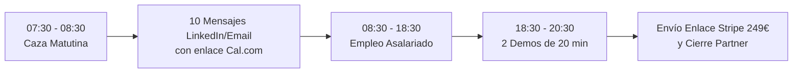

# MUNDO REAL: CENTRO DE OPERACIONES Y LANZAMIENTO COMERCIAL
## SISTEMA OPERATIVO DE COBRO, BLINDAJE, INTELIGENCIA Y VENTAS B2B (2026)

> **Fundador:** Cristian Jiménez Martínez  
> **Producto:** Bentian (ERP Bridge) — Pasarela Local-First Factusol ↔ WooCommerce / PrestaShop  
> **Condición:** Régimen de Pluriactividad (07:30-08:30 y 18:30-20:30)  
> **Presupuesto Inicial:** 500 € | **Meta Financiera:** 4.000 € limpios/mes en 24 meses

---

## 1. ESTRUCTURA DE LA SUITE OPERATIVA

Esta carpeta contiene la infraestructura jurídica, fiscal, competitiva y comercial lista para salir al mercado sin teoría vacía. Cada archivo es un instrumento de trabajo ejecutable:

```
mundo-real/
├── 01-activacion-y-cobro/
│   ├── stripe-setup-produccion.md           <- Guía paso a paso Stripe Billing, IVA 21% y enlaces de cobro
│   ├── checklist-alta-autonomo-48h.md        <- Trámites AEAT 036 (IAE 845/763, ROI) e Import@ss en 48h
│   └── contratos-y-terminos/
│       ├── EULA-instalador.md               <- Licencia de uso con anti-reversa, HWID y límite responsabilidad
│       ├── NDA-partners.md                  <- Acuerdo confidencialidad con penalización de 30.000€
│       └── DPA-rgpd-local-first.md          <- Contrato RGPD Art. 28 demostrando cero custodia cloud
├── 02-inteligencia-competitiva/
│   ├── mapa-competidores-espana.md          <- Radiografía de Festeweb, Conecta HUB, DELSOL y scripts
│   ├── matriz-diferenciacion-frontal.md     <- Benchmarking multidimensional y análisis de brechas
│   └── battlecard-demolicion-objeciones.md  <- Respuestas exactas para agencias, técnicos IT y gerentes
├── 03-herramientas-prospeccion/
│   ├── dorks-y-busquedas-deep-search.md     <- Google Dorks, PublicWWW, BuiltWith y LinkedIn Booleans
│   ├── filtro-cualificacion-leads.md        <- Protocolo semáforo en 3 min para no perder tiempo
│   └── directorio-leads-calientes.md        <- Lista de agencias, técnicos y caso Suministros Rubio
├── 04-playbooks-outreach/
│   ├── scripts-personalizados-por-vertical.md <- Mensajes de alta conversión (agencias, IT, suministros)
│   └── secuencia-asincrona-pluriactividad.md  <- Cronograma diario 07:30 / 18:30 y cadencia 14 días
└── README.md                                <- Este índice ejecutivo maestro
```

---

## 2. GUÍA DE EJECUCIÓN PASO A PASO (CÓMO USARLO DESDE MAÑANA)

### FASE A: ACTIVACIÓN FISCAL Y DE COBRO (DÍAS 1 Y 2)
1. **Paso 1:** Abrir `01-activacion-y-cobro/checklist-alta-autonomo-48h.md`. Presentar Modelo 036 en AEAT (IAE 845 y 763, ROI casilla 582) y alta RETA en Import@ss con Tarifa Plana de 80€/mes.
2. **Paso 2:** Abrir `01-activacion-y-cobro/stripe-setup-produccion.md`. Crear cuenta en Stripe, activar Stripe Tax con código `txcd_10202000`, y crear los dos Payment Links:
   - **Plan Anual:** 249,00 €/año (+ IVA).
   - **Plan Mensual:** 29,00 €/mes (+ IVA).
3. **Paso 3:** Tener impresos en PDF con tus datos completados los contratos de `01-activacion-y-cobro/contratos-y-terminos/`:
   - [EULA-instalador.md](file:///g:/Otros%20ordenadores/Mi%20PC/Bentian/mundo-real/01-activacion-y-cobro/contratos-y-terminos/EULA-instalador.md)
   - [NDA-partners.md](file:///g:/Otros%20ordenadores/Mi%20PC/Bentian/mundo-real/01-activacion-y-cobro/contratos-y-terminos/NDA-partners.md)
   - [DPA-rgpd-local-first.md](file:///g:/Otros%20ordenadores/Mi%20PC/Bentian/mundo-real/01-activacion-y-cobro/contratos-y-terminos/DPA-rgpd-local-first.md)

---

### FASE B: RUTINA DIARIA DE VENTAS ASÍNCRONA (LUNES A VIERNES)
Sigue religiosamente la rutina de `04-playbooks-outreach/secuencia-asincrona-pluriactividad.md`:



1. **A las 07:30 AM:** Ejecuta los dorks de [dorks-y-busquedas-deep-search.md](file:///g:/Otros%20ordenadores/Mi%20PC/Bentian/mundo-real/03-herramientas-prospeccion/dorks-y-busquedas-deep-search.md) o selecciona 10 objetivos de [directorio-leads-calientes.md](file:///g:/Otros%20ordenadores/Mi%20PC/Bentian/mundo-real/03-herramientas-prospeccion/directorio-leads-calientes.md).
2. **A las 08:00 AM:** Aplica el [filtro-cualificacion-leads.md](file:///g:/Otros%20ordenadores/Mi%20PC/Bentian/mundo-real/03-herramientas-prospeccion/filtro-cualificacion-leads.md) y envía los 10 mensajes personalizados usando los guiones de [scripts-personalizados-por-vertical.md](file:///g:/Otros%20ordenadores/Mi%20PC/Bentian/mundo-real/04-playbooks-outreach/scripts-personalizados-por-vertical.md).
3. **A las 08:30 AM:** Cierras el portátil de Bentian y atiendes tu empleo con absoluta tranquilidad. Tu agenda de Cal.com solo permite reservas a partir de las 18:30.
4. **A las 18:30 PM:** Te conectas a las videollamadas agendadas con la [battlecard-demolicion-objeciones.md](file:///g:/Otros%20ordenadores/Mi%20PC/Bentian/mundo-real/02-inteligencia-competitiva/battlecard-demolicion-objeciones.md) en una segunda pantalla para responder a cualquier duda en 30 segundos.
5. **A las 20:00 PM:** Envías el enlace de Stripe de 249 €/año o el acuerdo de Partner con el 25% de comisión recurrente.

---

## 3. LA PALANCA DEL CANAL PARTNER (POR QUÉ GANAMOS)

No vendemos a puerta fría a 250 PYMEs una a una. **Vendemos a las agencias web y a los técnicos de mantenimiento informático**:

```text
               ┌────────────────────────────────────────────────────────┐
               │         Cristian Jiménez (Bentian Local-First)          │
               └───────────────────────────┬────────────────────────────┘
                                           │
                        Alianzas Partner (25% recurrente)
                                           │
              ┌────────────────────────────┴────────────────────────────┐
              ▼                                                         ▼
    ┌──────────────────────┐                                  ┌──────────────────────┐
    │ Agencias Web / Devs  │                                  │ Empresas Mant. IT    │
    │ (WooCommerce/Presta) │                                  │ (Polígonos / DELSOL) │
    └──────────┬───────────┘                                  └──────────┬───────────┘
               │                                                         │
               │ Ganan: 100% del setup (300-600€)                        │ Ganan: 62,25€/año por PC
               │ + 62,25€/año recurrente sin soporte                     │ + Cero puertos abiertos
               ▼                                                         ▼
       [3-10 Clientes PYME]                                      [5-20 Clientes PYME]
```

* **Para la Agencia:** Se ahorra semanas de programación, cobra 300€-600€ de instalación a su cliente y recibe un cheque recurrente cada año.
* **Para el Técnico IT:** No asume riesgos en el firewall (tráfico saliente TLS 1.3 puro) y genera ingresos pasivos en su cartera.
* **Para Cristian:** Cada partner cerrado multiplica las ventas automáticamente sin coste de adquisición adicional.

---

## 4. METAS FINANCIERAS CLARAS

* **Punto de Equilibrio (Break-Even):** 1 cliente (249 €) cubre la cuota de autónomo (80 €) y el registro territorial de la propiedad intelectual (15 €).
* **Hito Mes 6:** 10 agencias partner activas = 40 licencias = **9.960 € ARR**.
* **Hito Mes 12:** 25 agencias partner = 100 licencias = **24.900 € ARR**.
* **Hito Mes 24 (La Meta):** 45 agencias e instaladores = 200 licencias = **49.800 € ARR (~4.150 € limpios/mes recurrentes)**.

Todo el material está listo. La ejecución comienza mañana a las 07:30 AM.
